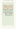

# Casa Aberta — Gerador de plantas de casas

Editor open source em português para estudar uma casa: **planta 2D cotada,
modelo 3D e exportações**, a partir de um único projeto em metros. Funciona no
navegador, sem conta e sem serviço de IA obrigatório.

Inspirado em um estudo residencial do autor, reimplementado como ferramenta
genérica. Nenhuma planta familiar, foto pessoal, revisão privada, endereço ou
credencial do projeto de origem é distribuída.

## Começar

Requer **Node.js 22.12+** e npm. A primeira instalação precisa de internet.

```sh
git clone https://github.com/martinlofranodeoliveira/gerador-plantas-casas.git
cd gerador-plantas-casas
npm ci --ignore-scripts
npm run dev
```

Abra o endereço de loopback exibido pelo Vite. O servidor fica em `127.0.0.1`.
Depois de instalar, o editor não consulta serviços externos: Three.js e os
demais arquivos são empacotados localmente. Uma GPU com WebGL é necessária para
o 3D; o editor 2D continua útil em dispositivos sem suporte gráfico.

## O que você pode fazer

- Informar largura/profundidade do terreno, recuos e quantidade de quartos.
- Gerar uma distribuição paramétrica com sala, cozinha/jantar, quartos,
  banheiro, serviço e circulação central de 1 m livre na configuração inicial.
- Arrastar ambientes na grade de 0,10 m, acompanhar X/Y em metros e confirmar a posição.
- Selecionar ambientes e editar nome, uso, posição e dimensões pelos campos.
- Ampliar a planta até 800% para ler as cotas e navegar pelas barras de rolagem.
- Adicionar/remover ambientes, portas e janelas, incluindo peitoril e altura.
- Ajustar espessura e altura das paredes; compartilhar paredes sem duplicação.
- Ver avisos de sobreposição e desrespeito aos recuos informados.
- Desfazer/refazer até 60 estados e salvar no armazenamento deste navegador.
- Importar e exportar o projeto JSON para continuar em outro computador.
- Exportar planta **SVG**, imagem **PNG** limitada a 4 megapixels/2200 px por lado, quadro de áreas **CSV**, prompt
  ilustrativo e um passeio orbital **WebM** de oito segundos pelo modelo 3D.
- Alternar paredes cortadas/inteiras e enquadrar o terreno na vista 3D.

Na planta 2D, arraste um ambiente ou dê foco a ele com Tab e use as setas.
As cotas X/Y mostram a posição proposta dos eixos a partir da origem do terreno.
Soltar mantém a prévia aberta. Confirme com Enter ou **Confirmar**, ou volte com
Escape ou **Cancelar**. Uma sobreposição ou invasão de recuo bloqueia a confirmação.
Cada movimento confirmado ocupa uma etapa de desfazer. Os campos de posição
continuam aceitando medidas com resolução de 1 mm. Plantas com erros podem ser
salvas em JSON; corrija os avisos para exportar imagens.

## Medidas: como interpretar

Todas as entradas são em **metros**, com resolução de **1 mm**. Coordenadas e
dimensões dos módulos referem-se aos **eixos das paredes**. A largura livre é
`largura do módulo − espessura da parede`; a profundidade segue a mesma regra.
A área interna livre é o produto dessas duas medidas. Exemplo: módulo de
4 × 5 m com parede de 0,15 m resulta em 3,85 × 4,85 m livres, ou 18,6725 m².

A origem fica na frente/esquerda do lote: X para a direita e Y para os fundos.
Os recuos são conferidos contra a **face externa** da parede. Paredes comuns
têm a mesma linha de eixo e são emitidas uma única vez. Aberturas compartilhadas
cortam a mesma geometria que aparece na planta e no modelo 3D.

SVG informa tamanho físico e escala 1:50, 1:100 ou 1:200. Para conferir a escala,
imprima a **100%**, sem “ajustar à página”, e meça a barra gráfica. PNG e WebM
são representações visuais: não possuem escala física confiável de impressão.
O CSV informa área **livre** por ambiente, não área legal construída.



## Limites importantes

Este é um **estudo preliminar**, não um projeto executivo/CAD/BIM completo.
A proposta organiza módulos; não otimiza automaticamente orientação solar,
topografia, ventilação, instalações, estrutura, acessibilidade ou regras locais.
Não consulta legislação nem define recuos obrigatórios. Confirme as medidas do
terreno e a viabilidade com arquiteto/engenheiro antes de construir ou aprovar.

O gerador aceita 1–4 quartos, terreno entre 3 e 100 m em cada dimensão e até
40 ambientes/160 aberturas no editor. Programas que não cabem são recusados.
Ambientes são retangulares, em um pavimento. Paredes são ortogonais; não há
telhados técnicos, escadas, cálculo estrutural, DXF, IFC, orçamento de obra,
dimensionamento de passagem ou certificação de acessibilidade.

O passeio WebM é uma câmera orbital externa com visão de maquete; não é navegação
interna com colisão. MediaRecorder/captureStream precisam estar disponíveis no
navegador. Exporte JSON antes de limpar os dados do navegador.

## Imagem de IA opcional

O editor já exporta PNG da planta e do modelo **sem custo de API**. Para uma
imagem conceitual com um provedor externo, o script abaixo é uma opção separada.
Ele não recebe suas chaves pelo navegador e não carrega `.env` automaticamente.

```sh
# Primeiro veja o prompt, sem rede e sem custo:
node scripts/generate-image.mjs examples/casa-exemplo.json fachada.png

# Se quiser fazer UMA chamada paga, configure a própria chave no ambiente
# pelo seu gerenciador de segredos e escolha explicitamente o modelo:
node scripts/generate-image.mjs examples/casa-exemplo.json fachada.png \
  --model gpt-image-2.5-sunburst --confirm-paid-request
```

Requer `OPENAI_API_KEY` no processo e acesso ao modelo escolhido. O script usa
o endpoint oficial `/v1/images/generations`, uma imagem PNG, sem retentativa
automática e sem sobrescrever o destino. A chamada envia o programa resumido
da casa ao provedor. Use dados fictícios ou que você esteja autorizado a enviar.
Preço, disponibilidade e tratamento de dados seguem a sua conta do provedor.
Consulte a [referência oficial de geração de imagens](https://developers.openai.com/api/reference/resources/images/methods/generate).

**Imagens de IA são ilustrativas e podem divergir da geometria.** JSON/SVG são a
referência dimensional. Uma imagem bonita não comprova uma planta tecnicamente
correta. Em uma falha incerta, o arquivo reservado pode permanecer vazio; confira
o uso no provedor e escolha outro destino antes de decidir repetir.

## Construir, testar e hospedar

```sh
npm test
npm run build
npm run preview
```

`dist/` pode ser servido em hospedagem estática. Não é necessário backend.
O CI executa testes de geometria/exports/adaptador e build; o adaptador de imagem
é testado com resposta fictícia, sem chamadas pagas ou credenciais.

Nesta entrega, o teste visual interativo não pôde ser executado porque o controle
de navegador da sessão estava desativado. A validação de código e build não prova
compatibilidade de WebGL/gravação em todos os dispositivos. Registre navegador,
sistema e um JSON sintético ao relatar um problema.

## Estrutura e contribuição

| Caminho | Responsabilidade |
| --- | --- |
| `src/core.js` | Contrato, validação, geração, paredes, áreas e histórico |
| `src/plan.js` | SVG cotado, CSV e prompt ilustrativo |
| `src/model.js` | Maquete Three.js, captura PNG e câmera WebM |
| `src/app.js` | Editor, formulários, seleção, armazenamento e downloads |
| `scripts/generate-image.mjs` | Integração paga opcional, explícita e sem retry |
| `examples/` | Projeto fictício em formato aberto |
| `tests/` | Geometria, erros, não mutação, exports e HTTP fictício |

Veja [CONTRIBUTING.md](CONTRIBUTING.md), [SECURITY.md](SECURITY.md),
[o formato JSON](docs/FORMATO.md) e [ROADMAP.md](ROADMAP.md).
Preserve os testes e inclua exemplos sintéticos; nunca publique dados de uma
casa real sem autorização. Não faça commits vazios nem fragmente mudanças
somente para aumentar estatísticas.

## Licença

[MIT](LICENSE), copyright 2026 Martin Lofrano de Oliveira.
Three.js e Vite mantêm suas próprias licenças MIT; veja
[THIRD_PARTY_NOTICES.md](THIRD_PARTY_NOTICES.md). Código novo com auxílio de IA;
origem conceitual registrada sem redistribuir o acervo residencial privado.

**English:** a Portuguese-first, browser-local metric floor-plan editor with
orthogonal room modules, shared walls, 2D SVG/PNG, a Three.js model, WebM orbit,
JSON persistence and CSV areas. This is preliminary design software, not a
construction-ready plan or a replacement for a licensed professional.
